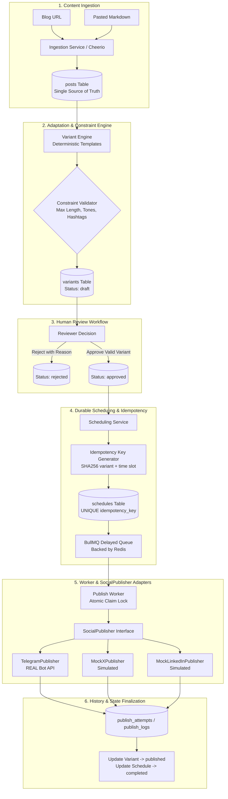

# Social Media Studio — System Design Document (DESIGN.md)

**Project:** FlyRank Capstone — Social Media Studio  
**Repository:** `flyrank-capstone-social-studio`  
**Phase:** Phase 1 Design Gate  

---

## 1. Problem Statement

Publishing blog content across multiple social media platforms is manual, error-prone, and repetitive. Each social network imposes strict, conflicting content constraints (e.g., character limits, hashtag density, tone norms, and formatting rules). Furthermore:
- Content editors lack a single source of truth for original blog material and adapted platform variants.
- Without a formalized human-in-the-loop review workflow, unvetted or non-compliant drafts risk being published.
- Scheduling social posts without durable infrastructure and idempotency leads to missed publications, duplicated posts upon worker restarts, or race conditions.

---

## 2. System Goal

The goal of **Social Media Studio** is to provide a robust, resilient backend system that:
1. Ingests long-form blog content from Markdown or live URLs into a persistent Single Source of Truth (SSOT).
2. Generates platform-tailored message variants (Telegram, X, LinkedIn) respecting platform-specific constraint profiles.
3. Enforces a human-in-the-loop review workflow with strict gating (`draft` $\to$ `approved` / `rejected` $\to$ `published`).
4. Executes durable, delayed scheduling via **BullMQ** and **Redis**.
5. Dispatches publications polymorphically via a unified `SocialPublisher` interface to a real target (**Telegram**) and simulated targets (**MockX**, **MockLinkedIn**).
6. Guarantees **idempotent execution** (same variant + same time slot = exactly one publish) across crashes and retries.
7. Maintains a permanent audit history of all publication attempts.

---

## 3. Architecture Diagram



---

## 4. Data Model (SQLite Schema)

All tables use SQLite WAL mode (`PRAGMA journal_mode = WAL`) and enforce foreign key constraints (`PRAGMA foreign_keys = ON`).

### 1. `posts` (Single Source of Truth)
| Column | Type | Constraints | Description |
|---|---|---|---|
| `id` | TEXT | PRIMARY KEY | Unique post ID (UUID v4) |
| `title` | TEXT | NOT NULL | Title of the blog post |
| `source_type` | TEXT | CHECK(`source_type` IN ('url', 'markdown')) | Ingestion source channel |
| `source_url` | TEXT | NULLABLE | Original URL (if ingested from web) |
| `raw_content` | TEXT | NOT NULL | Complete raw Markdown / scraped text |
| `summary` | TEXT | NULLABLE | Extracted/generated core summary |
| `metadata_json` | TEXT | DEFAULT '{}' | Word count, reading time, author, tags |
| `created_at` | DATETIME | DEFAULT CURRENT_TIMESTAMP | Ingestion timestamp |
| `updated_at` | DATETIME | DEFAULT CURRENT_TIMESTAMP | Last update timestamp |

### 2. `constraint_profiles`
| Column | Type | Constraints | Description |
|---|---|---|---|
| `id` | TEXT | PRIMARY KEY | Profile ID (e.g. `cp_telegram`, `cp_x`) |
| `platform` | TEXT | UNIQUE NOT NULL | `telegram`, `x`, `linkedin` |
| `max_length` | INTEGER | NOT NULL | Maximum permitted total character count |
| `allowed_tones_json` | TEXT | NOT NULL | Whitelist JSON array of valid tones |
| `max_hashtags` | INTEGER | NOT NULL | Maximum number of allowed hashtags |
| `min_hashtags` | INTEGER | DEFAULT 0 | Minimum number of required hashtags |
| `media_allowed` | INTEGER | DEFAULT 1 | Boolean (0 or 1) |
| `created_at` | DATETIME | DEFAULT CURRENT_TIMESTAMP | Creation timestamp |
| `updated_at` | DATETIME | DEFAULT CURRENT_TIMESTAMP | Last update timestamp |

### 3. `post_variants` (`variants`)
| Column | Type | Constraints | Description |
|---|---|---|---|
| `id` | TEXT | PRIMARY KEY | Unique variant ID (UUID v4) |
| `post_id` | TEXT | NOT NULL, FK $\to$ `posts(id)` ON DELETE CASCADE | Associated parent post |
| `platform` | TEXT | NOT NULL CHECK(`platform` IN ('telegram', 'x', 'linkedin')) | Target social network |
| `content` | TEXT | NOT NULL | Platform-tailored message content |
| `hashtags_json` | TEXT | DEFAULT '[]' | JSON array of assigned hashtags |
| `tone` | TEXT | NOT NULL | Tone of the variant |
| `status` | TEXT | DEFAULT 'draft' CHECK(`status` IN ('draft', 'approved', 'rejected', 'published')) | Review lifecycle status |
| `rejection_reason` | TEXT | NULLABLE | Reason if variant was rejected |
| `validation_status` | TEXT | DEFAULT 'pending' CHECK(`validation_status` IN ('pending', 'valid', 'invalid')) | Constraint check status |
| `validation_errors_json` | TEXT | DEFAULT '[]' | Detailed rule violation descriptions |
| `created_at` | DATETIME | DEFAULT CURRENT_TIMESTAMP | Creation timestamp |
| `updated_at` | DATETIME | DEFAULT CURRENT_TIMESTAMP | Last update timestamp |

### 4. `schedules` (`jobs`)
| Column | Type | Constraints | Description |
|---|---|---|---|
| `id` | TEXT | PRIMARY KEY | Schedule slot ID (UUID v4) |
| `variant_id` | TEXT | NOT NULL, FK $\to$ `post_variants(id)` ON DELETE CASCADE | Target variant |
| `scheduled_time` | DATETIME | NOT NULL | Target execution timestamp (ISO 8601) |
| `idempotency_key` | TEXT | UNIQUE NOT NULL | $\text{SHA256}(\text{variant\_id} + \text{ISO\_ROUNDED\_SLOT})$ |
| `status` | TEXT | DEFAULT 'queued' CHECK(`status` IN ('queued', 'processing', 'completed', 'failed', 'cancelled')) | Queue processing status |
| `job_id` | TEXT | NULLABLE | BullMQ Job ID |
| `created_at` | DATETIME | DEFAULT CURRENT_TIMESTAMP | Creation timestamp |
| `updated_at` | DATETIME | DEFAULT CURRENT_TIMESTAMP | Last update timestamp |

### 5. `publish_logs` (`publish_attempts`)
| Column | Type | Constraints | Description |
|---|---|---|---|
| `id` | TEXT | PRIMARY KEY | Log entry ID (UUID v4) |
| `schedule_id` | TEXT | NULLABLE, FK $\to$ `schedules(id)` ON DELETE SET NULL | Related schedule slot |
| `variant_id` | TEXT | NOT NULL, FK $\to$ `post_variants(id)` ON DELETE CASCADE | Published variant |
| `platform` | TEXT | NOT NULL | Target platform name |
| `idempotency_key` | TEXT | NOT NULL | Deterministic key for the attempt |
| `attempt_number` | INTEGER | NOT NULL DEFAULT 1 | Retry counter |
| `status` | TEXT | NOT NULL CHECK(`status` IN ('success', 'failure')) | Execution result |
| `external_post_id` | TEXT | NULLABLE | Real Telegram `message_id` or mock ID |
| `request_payload_json` | TEXT | NULLABLE | Outgoing payload dispatched |
| `response_payload_json` | TEXT | NULLABLE | Raw API response received |
| `error_message` | TEXT | NULLABLE | Detailed error if attempt failed |
| `duration_ms` | INTEGER | NOT NULL | HTTP round-trip duration in ms |
| `created_at` | DATETIME | DEFAULT CURRENT_TIMESTAMP | Execution timestamp |

---

## 5. API Surface

| Endpoint | Method | Request Body / Query | Description |
|---|---|---|---|
| `/api/posts/ingest/markdown` | `POST` | `{ title?: string, markdown: string, metadata?: object }` | Ingest long-form blog post from Markdown |
| `/api/posts/ingest/url` | `POST` | `{ url: string }` | Fetch, scrape, and ingest blog post from URL |
| `/api/posts` | `GET` | `?limit=20&offset=0` | List stored blog posts |
| `/api/posts/:id` | `GET` | — | Retrieve single post with child variants |
| `/api/posts/:id/generate-variants` | `POST` | `{ platforms?: string[], tone?: string }` | Generate deterministic platform variants |
| `/api/posts/:id/variants` | `POST` | `{ platform, content, tone, hashtags }` | Create manual custom variant |
| `/api/variants/:id` | `PATCH` | `{ content?, tone?, hashtags? }` | Edit variant (resets to `draft`, re-validates) |
| `/api/variants/:id/approve` | `POST` | — | Approve variant (requires `valid` validation status) |
| `/api/variants/:id/reject` | `POST` | `{ reason: string }` | Reject variant with required explanation |
| `/api/variants/:id/schedule` | `POST` | `{ scheduled_time: string (ISO 8601) }` | Schedule approved variant (creates BullMQ job) |
| `/api/variants/:id/publish-now` | `POST` | — | Immediately dispatch approved variant |
| `/api/schedules` | `GET` | `?status=queued|processing|completed|failed` | List scheduled publishing slots |
| `/api/schedules/:id` | `DELETE` | — | Cancel pending scheduled slot |
| `/api/publish-logs` | `GET` | `?variantId=...&platform=...&status=...` | Query publication history and audit records |
| `/api/profiles` | `GET` | — | List platform constraint profiles |
| `/api/profiles/:platform` | `PUT` | `{ maxLength?, allowedTones?, maxHashtags?, minHashtags? }` | Update platform constraint limits |

---

## 6. Platform Constraint Profiles

Default profile configuration:

| Platform | Max Character Length | Allowed Tones Rule | Hashtag Range |
|---|---|---|---|
| **Telegram** | 4,096 | `["professional", "casual", "urgent", "informative", "engaging"]` | 0 – 10 hashtags |
| **MockX (Twitter)** | 280 | `["casual", "urgent", "witty", "punchy", "informative"]` | 1 – 4 hashtags |
| **MockLinkedIn** | 3,000 | `["professional", "thought-leadership", "industry-insight", "informative"]` | 2 – 5 hashtags |

### Validation Rule Checks:
1. `(content.length + hashtags_length) <= profile.max_length`
2. `profile.allowed_tones.includes(variant.tone.toLowerCase())`
3. `variant.hashtags.length >= profile.min_hashtags && variant.hashtags.length <= profile.max_hashtags`
4. Non-empty text verification.

---

## 7. SocialPublisher Interface

A clean polymorphic interface ensuring consistent contract across all platform adapters:

```javascript
/**
 * @typedef {Object} PublishContext
 * @property {string} scheduleId
 * @property {string} variantId
 * @property {string} platform
 * @property {boolean} [immediate]
 */

/**
 * @typedef {Object} PublishResult
 * @property {boolean} success - Whether publishing succeeded
 * @property {string|null} externalPostId - Platform external ID (e.g. Telegram message_id or Mock ID)
 * @property {object} [rawResponse] - Full raw response from platform API
 * @property {string} [error] - Error message if failed
 * @property {number} durationMs - Execution time in milliseconds
 */

export class SocialPublisher {
  constructor(platformName) {
    if (new.target === SocialPublisher) {
      throw new TypeError("Cannot construct SocialPublisher instances directly");
    }
    this.platform = platformName;
  }

  /**
   * Publish variant content to the target social platform.
   * @param {Object} payload
   * @param {string} payload.content
   * @param {string[]} payload.hashtags
   * @param {string} payload.idempotencyKey
   * @param {PublishContext} [payload.metadata]
   * @returns {Promise<PublishResult>}
   */
  async publish(payload) {
    throw new Error(`Method 'publish()' must be implemented by ${this.constructor.name}`);
  }
}
```

### Adapters:
- **`TelegramPublisher` (Real Target):** Connects to `https://api.telegram.org/bot<TOKEN>/sendMessage`. Formats messages with HTML and parses real Telegram `message_id`.
- **`MockXPublisher` (Simulated Target):** Generates synthetic tweet IDs (`tw_<timestamp>_<rand>`) with 150ms simulated network latency and configurable failure rates.
- **`MockLinkedInPublisher` (Simulated Target):** Generates standard LinkedIn Share URNs (`urn:li:share:<uuid>`) with 180ms latency.

---

## 8. Idempotency Strategy

The system guarantees **exactly-once publishing** for any `(variant + time slot)` combination through a three-layer defense:

1. **Deterministic Idempotency Key**:
   $$\text{Idempotency Key} = \text{SHA256}(\text{variant\_id} + \text{ISO\_ROUNDED\_SLOT})$$
   Timestamps are rounded to the nearest second slot (e.g. `2026-10-02T15:30:00Z`), neutralizing millisecond clock drift between concurrent requests.

2. **Database Uniqueness Constraint**:
   The `schedules` table enforces `UNIQUE(idempotency_key)`. Any duplicate schedule attempt for the same variant and slot is rejected immediately with HTTP 409 (`DUPLICATE_SCHEDULE_SLOT`).

3. **Worker-Level Atomic Claim & Audit Verification**:
   - Before invoking any adapter, the worker runs an atomic SQL lock:
     ```sql
     UPDATE schedules 
     SET status = 'processing', updated_at = CURRENT_TIMESTAMP 
     WHERE id = :scheduleId AND status = 'queued';
     ```
     If 0 rows are affected (e.g., another worker thread claimed it), the job skips execution immediately.
   - Pre-dispatch check: If `publish_logs` already contains a `success` entry for the `idempotency_key`, the worker marks the schedule `completed` and exits without making external API calls.

---

## 9. Durable Scheduling Strategy

```
               ┌──────────────────────────────┐
               │    POST /variants/:id/schedule
               └──────────────┬───────────────┘
                              │
               ┌──────────────▼───────────────┐
               │  Save to SQLite `schedules`  │
               └──────────────┬───────────────┘
                              │
               ┌──────────────▼───────────────┐
               │  Add to BullMQ Delayed Queue │
               │  (delay = targetTime - now)  │
               └──────────────┬───────────────┘
                              │
             ┌────────────────┴────────────────┐
             ▼                                 ▼
      [Worker Active]                  [Worker Crashes]
             │                                 │
   Wait delay & process                Server reboots
             │                                 │
   Publish & write log                 ReconciliationService
                                       recovers queued slots
```

### Key Components:
- **BullMQ + Redis Delayed Jobs:** Schedules are pushed to BullMQ with `delay = max(0, targetTime - Date.now())` and `jobId = job_${scheduleId}`.
- **Persistent Job Metadata:** All critical parameters (`scheduleId`, `variantId`, `platform`, `idempotencyKey`) reside in SQLite as the source of truth and are duplicated in the BullMQ job payload.
- **Dual-Mode Queue Driver:** Supports full Redis clustering in production while providing zero-config in-memory fallback for local development and testing.
- **Worker Restart & Crash Recovery (`ReconciliationService`):**
  - Upon server boot, `ReconciliationService` scans SQLite for any schedules with `status IN ('queued', 'processing')`.
  - For each uncompleted slot, it verifies against `publish_logs`.
  - If unpublished, it immediately re-enqueues the job into BullMQ with appropriate remaining delay (or delay 0 if the scheduled time passed during downtime).

---

## 10. Review State Machine

```
                   ┌──────────┐
                   │  Draft   │ ◄─────── (Content Edit resets to Draft)
                   └────┬─────┘
                        │
          ┌─────────────┴─────────────┐
          ▼                           ▼
    ┌───────────┐               ┌───────────┐
    │ Approved  │               │ Rejected  │
    └─────┬─────┘               └───────────┘
          │
          │ (Triggered by Schedule or PublishNow)
          ▼
    ┌───────────┐
    │ Published │
    └───────────┘
```

### State Transition Rules:
- `draft` $\to$ `approved`: Allowed ONLY if `validation_status == 'valid'`.
- `draft` $\to$ `rejected`: Allowed with a mandatory rejection reason.
- `approved` $\to$ `rejected`: Allowed if reviewer changes decision before publish.
- `rejected` $\to$ `approved`: Allowed if reviewer re-approves after re-evaluation.
- `approved` $\to$ `published`: Occurs strictly upon successful adapter publish execution.

### Explicitly Blocked Transitions:
- `draft` $\to$ `scheduled` ❌ (Forbidden: 400 Bad Request)
- `draft` $\to$ `published` ❌ (Forbidden: 400 Bad Request)
- `rejected` $\to$ `scheduled` ❌ (Forbidden: 400 Bad Request)
- `rejected` $\to$ `published` ❌ (Forbidden: 400 Bad Request)

---

## 11. Explicit Non-Goals

1. **Real External Social Publishing (X, LinkedIn, Instagram, TikTok):**  
   *Telegram is the sole real publishing target.* Real publishing to X (Twitter), LinkedIn, Instagram, or Facebook is explicitly **out of scope**. X and LinkedIn are strictly handled by simulated mock adapters adhering to the `SocialPublisher` interface.
2. **Paid External AI API Requirements:**  
   The core system uses deterministic, rule-based template generation; no paid OpenAI/Anthropic/Google AI API keys or credit cards are required.
3. **Heavy Frontend Framework:**  
   The project focuses on backend architecture, API contracts, durable scheduling, and review workflow.

---

## 12. Security & Secrets Strategy

1. **Zero Hardcoded Secrets:** All credentials (`TELEGRAM_BOT_TOKEN`, `TELEGRAM_CHAT_ID`, `REDIS_PASSWORD`) are loaded strictly from environment variables via `dotenv` and validated at startup using **Zod** (`src/config/env.js`).
2. **Version Control Protection:** `.env` and SQLite database binaries (`*.sqlite`, `*.sqlite-wal`) are strictly ignored in `.gitignore`. A clean `.env.example` is provided with dummy placeholders.
3. **Input Sanitization & Injection Defense:**
   - All SQLite queries use parameterized prepared statements via `better-sqlite3`, preventing SQL injection.
   - All incoming HTTP payloads are validated against strict Zod schemas before reaching controllers.
   - Telegram HTML messages sanitize dynamic content and provide a plain-text fallback to prevent formatting entity injection.

---

## 13. Testing Strategy

The test harness uses **Vitest** and **Supertest** covering 3 testing tiers:

1. **Unit Tests (`tests/unit/`):**
   - Ingestion: Markdown header extraction, word count, reading time, HTML scraping.
   - Constraint Validation: Character limits, tone whitelist, hashtag min/max rules.
   - Variant Generation: Deterministic platform templating.
   - Publishers: Telegram adapter error handling, MockX and MockLinkedIn payload shapes.
   - Idempotency: SHA-256 slot hashing and collision tests.
2. **Integration Tests (`tests/integration/`):**
   - `workflow.test.js`: Full lifecycle test from ingestion $\to$ variant $\to$ edit $\to$ review approval/rejection gating $\to$ schedule $\to$ worker execution $\to$ audit log verification.
   - `durableQueue.test.js`: Worker crash recovery simulation, database reconciliation verification, and rejection guard checks.
   - `api.test.js`: Supertest validation across all REST routes, status codes, and error responses.
3. **Execution Command:**
   ```bash
   npm test
   ```

---

## ✅ Verification of Phase 1 Design Gate

- [x] **Problem statement** clearly defined.
- [x] **System goal** formulated.
- [x] **Architecture diagram** provided with complete pipeline flow.
- [x] **Data model** designed with `posts`, `constraint_profiles`, `post_variants`, `schedules`, and `publish_logs` including primary keys, foreign keys, timestamps, and idempotency key.
- [x] **API surface** specified for ingestion, variants, review, scheduling, and logs.
- [x] **Platform constraint profiles** defined for Telegram, MockX, and MockLinkedIn.
- [x] **SocialPublisher interface** designed with return types.
- [x] **Idempotency strategy** detailed with SHA-256 and database uniqueness constraint.
- [x] **Durable scheduling strategy** with BullMQ, Redis, and crash recovery reconciliation.
- [x] **Review state machine** specified with forbidden transition enforcement.
- [x] **Explicit non-goal** stated.
- [x] **Security/secrets strategy** documented.
- [x] **Testing strategy** detailed.
