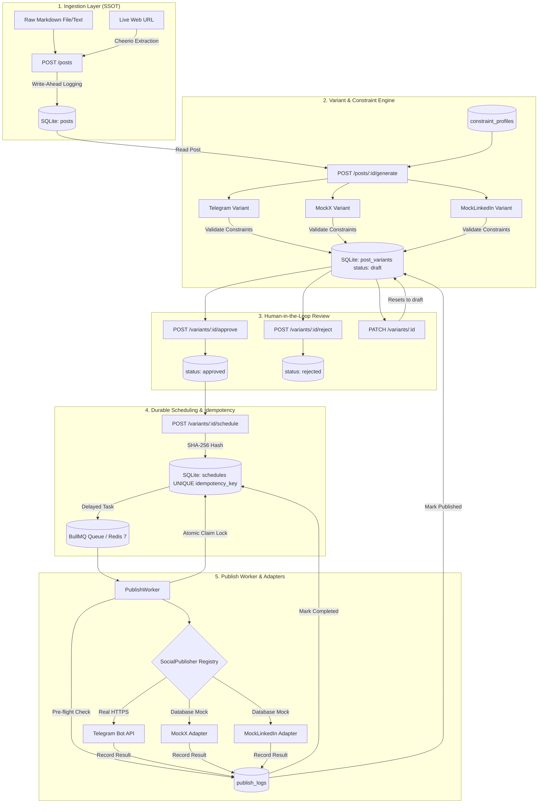

# FlyRank Social Media Studio

[](#running-tests)
[](https://nodejs.org)
[](https://github.com/WiseLibs/better-sqlite3)
[](https://bullmq.io)
[](https://www.docker.com)

**Social Media Studio** is an enterprise-grade backend service built in Node.js (ES Modules) that automates the lifecycle of transforming long-form blog articles into platform-optimized social media posts. The system ingests raw blog content from Markdown or live URLs, deterministically synthesizes platform-constrained variants, enforces human-in-the-loop editorial review, schedules durable publishing slots via BullMQ and Redis, and idempotently publishes to live Telegram channels and simulated social networks (MockX and MockLinkedIn) with SQLite as the Single Source of Truth (SSOT).

---

## Features

- **Multi-Source Ingestion & SSOT**: Ingests Markdown or live article URLs with Cheerio extraction; stored in SQLite WAL mode as the single source of truth.
- **Platform-Specific Variants**: Deterministic template engine synthesizing tailored variants for Telegram, X, and LinkedIn.
- **Constraint Enforcement**: Validates character lengths, allowed tone whitelists, and hashtag ranges with descriptive 4xx error reporting.
- **Human-in-the-Loop Review Workflow**: Robust state machine (`draft` $\to$ `approved` / `rejected` $\to$ `published`) preventing unapproved content from scheduling.
- **Polymorphic SocialPublisher Layer**: Unified publishing contract with zero `if/else` control flow branching in business logic.
- **Real Telegram Bot API Target**: Dispatches HTML-formatted broadcasts to live Telegram channels using environment variables.
- **Simulated Mock Adapters**: MockX and MockLinkedIn adapters generating character-counted previews and persisting intended payloads.
- **Database-Level Idempotency**: Unique constraints on $\text{SHA-256}(\text{variant\_id} + \text{slot})$ preventing duplicate publishing across retries.
- **Durable Scheduling & Crash Recovery**: Delayed BullMQ queue with startup `ReconciliationService` to survive worker reboots.
- **Comprehensive Audit Trail**: `GET /publish-history` and `GET /schedules` endpoints exposing detailed attempt logs.

---

## Architecture

```
Blog Input (URL / Markdown)
       │
       ▼
Ingestion & SQLite Storage (SSOT)
       │
       ▼
Deterministic Variant Generation
       │
       ▼
Constraint Profile Validation (Blocked if invalid)
       │
       ▼
Human Review Workflow (Draft -> Approved / Rejected)
       │
       ▼
Durable Scheduler (BullMQ + Redis 7)
       │
       ▼
Polymorphic SocialPublisher Interface
 ├─ TelegramPublisher (Real Target via Bot API)
 ├─ MockXPublisher (Database Mock with Preview)
 └─ MockLinkedInPublisher (Database Mock with Preview)
       │
       ▼
Publish History & Audit Trail (SQLite)
```



---

## Tech Stack

- **Runtime & Language:** Node.js (v20+ LTS / v24+), ES Modules (`"type": "module"`).
- **Web Framework:** Express 5 (`express`).
- **Database Engine:** SQLite 3 via `better-sqlite3` with Write-Ahead Logging (`WAL`) mode enabled.
- **Durable Queue & Scheduler:** BullMQ (`bullmq`) backed by Redis (`ioredis` / Redis 7).
- **Containerization:** Docker & Docker Compose (`redis:7-alpine`).
- **HTML Extraction:** Cheerio (`cheerio`) for semantic web scraping and OpenGraph metadata parsing.
- **Schema & Input Validation:** Zod (`zod`).
- **Testing & Mocking:** Vitest (`vitest`), Supertest (`supertest`), and `ioredis-mock`.

---

## Project Structure

```text
flyrank-capstone-social-studio/
├── .env.example              # Environment variable template (safe placeholders)
├── .gitignore                # Git ignore patterns (ignores .env, node_modules, data)
├── BUILDLOG.md               # Honest engineering and AI collaboration record
├── DESIGN.md                 # Architecture, data model, and interface specification
├── docker-compose.yml        # Docker Compose configuration for Redis 7
├── EVIDENCE.md               # Verified execution evidence for all 20 requirements
├── package.json              # Project scripts and dependencies
├── README.md                 # Complete system guide and documentation
├── src/
│   ├── api/                  # Express REST API, middleware, and route handlers
│   ├── config/               # Environment loading and platform constants
│   ├── db/                   # SQLite connection, schema migrations, and repositories
│   ├── ingestion/            # Markdown and Cheerio URL ingestion services
│   ├── publishers/           # SocialPublisher contract, Telegram, and Mock adapters
│   ├── queue/                # BullMQ delayed queue, worker, and reconciliation
│   ├── services/             # Core SocialStudio business service
│   ├── variants/             # Deterministic variant generator and constraint validator
│   ├── server.js             # API server entry point
│   ├── worker.js             # Standalone worker forwarding entry point
│   └── workers/
│       └── publishWorker.js  # Dedicated background worker entry point
└── tests/
    ├── integration/          # 12 Integration test suites (E2E, API, BullMQ, Idempotency)
    └── unit/                 # 5 Unit test suites (Constraints, Ingestion, Generator)
```

---

## Prerequisites

- **Node.js**: `v20.0.0` or higher installed (`node -v`).
- **Docker & Docker Compose**: Installed and running (for live Redis queue persistence).
- **Telegram Account (Optional for Real Target)**: A Telegram Bot Token from `@BotFather` and a channel/chat ID where the bot is an administrator.

---

## Environment Variables

Create your local `.env` file from the provided `.env.example`:

```bash
cp .env.example .env
```

| Variable | Type | Default | Description |
| :--- | :--- | :--- | :--- |
| `PORT` | Number | `3000` | Port for the Express API server. |
| `NODE_ENV` | String | `development` | Environment mode (`development`, `test`, `production`). |
| `DATABASE_PATH` | String | `./data/social_studio.sqlite` | SQLite database file location (`:memory:` supported). |
| `REDIS_HOST` | String | `127.0.0.1` | Redis host for BullMQ durable queuing. |
| `REDIS_PORT` | Number | `6379` | Redis port for BullMQ. |
| `REDIS_URL` | String | *(Optional)* | Full Redis connection URI (e.g. `redis://127.0.0.1:6379`). |
| `USE_IN_MEMORY_REDIS` | Boolean | `false` | Fallback in-memory queue mode when running without Redis. |
| `TELEGRAM_BOT_TOKEN` | String | `""` | Telegram Bot Token from `@BotFather` (never committed). |
| `TELEGRAM_CHAT_ID` | String | `""` | Telegram channel username (`@channel`) or chat ID (`-100...`). |
| `MOCK_X_FAILURE_RATE` | Number | `0` | Probability (0.0 - 1.0) of simulated Twitter/X failures. |
| `MOCK_LINKEDIN_FAILURE_RATE`| Number | `0` | Probability (0.0 - 1.0) of simulated LinkedIn failures. |

---

## Setup

1. **Clone the repository:**
   ```bash
   git clone <REPO_URL>
   cd flyrank-capstone-social-studio
   ```

2. **Install dependencies:**
   ```bash
   npm install
   ```

3. **Configure environment:**
   ```bash
   cp .env.example .env
   ```

4. **Start Redis container:**
   ```bash
   docker-compose up -d
   ```

---

## Running the Application

### Start API Server
```bash
npm run start:server
# Server runs on http://localhost:3000
```

### Start Publish Worker
```bash
npm run start:worker
# Worker connects to Redis, reconciles pending jobs, and listens for publish events
```

### Standalone Dev Mode (Embedded In-Memory Queue, No Docker required)
```bash
npm run dev
```

---

## Running Tests

Execute the complete automated test suite via Vitest:

```bash
npm test
```

### Verified Test Result:
```text
Test Files  17 passed (17)
     Tests  57 passed (57)
  Duration  5.82s
```

---

## Workflow

1. **Ingest Post:** Client sends Markdown or URL to `POST /posts`. The normalized post is saved in SQLite as the Single Source of Truth.
2. **Generate Variants:** Client calls `POST /posts/:id/generate`. Deterministic templates create variants for Telegram, MockX, and MockLinkedIn.
3. **Validate Constraints:** `ConstraintValidator` verifies length limits, allowed tones, and hashtag ranges. Violations are rejected before review.
4. **Human Review:** Editors review drafts via `GET /variants` and call `POST /variants/:id/approve` or `POST /variants/:id/reject`.
5. **Durable Schedule:** Approved variants are scheduled via `POST /variants/:id/schedule` with an ISO timestamp (`scheduled_for`).
6. **Queue Execution:** BullMQ triggers delayed jobs, claiming tasks atomically to prevent concurrency conflicts.
7. **Publish:** `SocialPublisher` adapter publishes to the real Telegram Bot API or persists mock publications for X and LinkedIn.
8. **Record Audit History:** Every attempt records status, duration, and external post IDs in `publish_logs`.

---

## Real vs Mock Publishing

- **Telegram (`TelegramPublisher`): REAL TARGET**
  - Sends live HTTPS requests to `https://api.telegram.org/bot<TOKEN>/sendMessage`.
  - Credentials come strictly from environment variables.
  - Generates real clickable Telegram channel links (`https://t.me/<channel>/<message_id>`).
- **X / Twitter (`MockXPublisher`): MOCK ADAPTER**
  - Simulates 280-character posting with synthetic latency.
  - Writes publication records to SQLite and generates realistic previews.
  - Does NOT connect to live Twitter/X APIs.
- **LinkedIn (`MockLinkedInPublisher`): MOCK ADAPTER**
  - Simulates 3,000-character thought-leadership posting.
  - Writes records to SQLite and returns URN identifiers (`urn:li:share:...`).
  - Does NOT connect to live LinkedIn APIs.

---

## Idempotency & Reliability

1. **Deterministic Slot Key:** Every scheduled publish generates an idempotency key derived from:
   $$\text{SHA-256}(\text{variant\_id} + \text{ISO\_ROUNDED\_SLOT})$$
2. **Database UNIQUE Constraints:**
   - Table `schedules` has a `UNIQUE` index on `idempotency_key`.
   - Table `publish_logs` has a partial unique index: `idx_publish_logs_unique_success ON publish_logs(idempotency_key) WHERE status = 'success'`.
3. **Atomic Worker Locking:** Workers claim jobs using `UPDATE schedules SET status = 'processing' WHERE id = ? AND status = 'queued'`. If 0 rows are updated, duplicate execution is averted.
4. **Worker Crash & Restart Recovery:** When the worker process restarts, `ReconciliationService.reconcile()` queries SQLite for pending/in-flight tasks and re-enqueues them into BullMQ with zero lost jobs and zero duplicate dispatches.

---

## Testing & Evidence

Refer to [EVIDENCE.md](./EVIDENCE.md) for execution logs, payloads, and automated test proofs covering all 20 core requirements, including the six reviewer probes and worker crash/restart survival.

---

## AI Usage

Refer to [BUILDLOG.md](./BUILDLOG.md) for transparent documentation of AI collaboration using Google DeepMind's Antigravity assistant, including phase-by-phase prompt history, AI generation areas, failure cases, and manual architectural corrections.

---

## Non-Goals & Limitations

- **Paid LLM APIs:** The system intentionally relies on deterministic template generators to avoid paid API tokens and credit card requirements.
- **Frontend User Interface:** This project is strictly a backend service with a REST API.
- **Live OAuth2 for X/LinkedIn:** Real OAuth credentials for X and LinkedIn are excluded per the specification; Mock adapters provide complete database auditing and preview generation.
- **Telegram Rate Limits:** Telegram Bot API limits channel broadcast throughput to ~20-30 messages per minute.

---

## Security

- Secrets and bot tokens are stored strictly in `.env` (ignored by `.gitignore` and never committed).
- `.env.example` provides safe placeholder variables only.
- Logs and audit history redact authorization headers and sensitive credentials.
