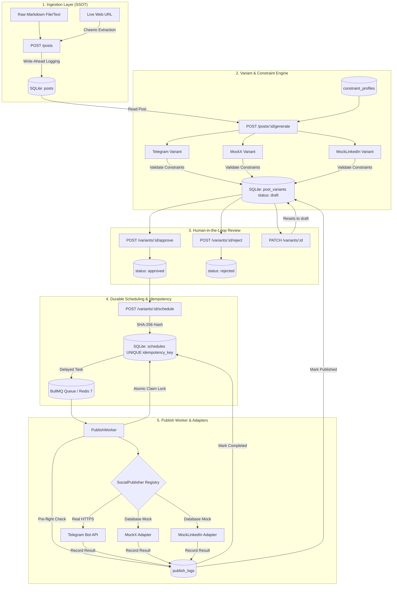
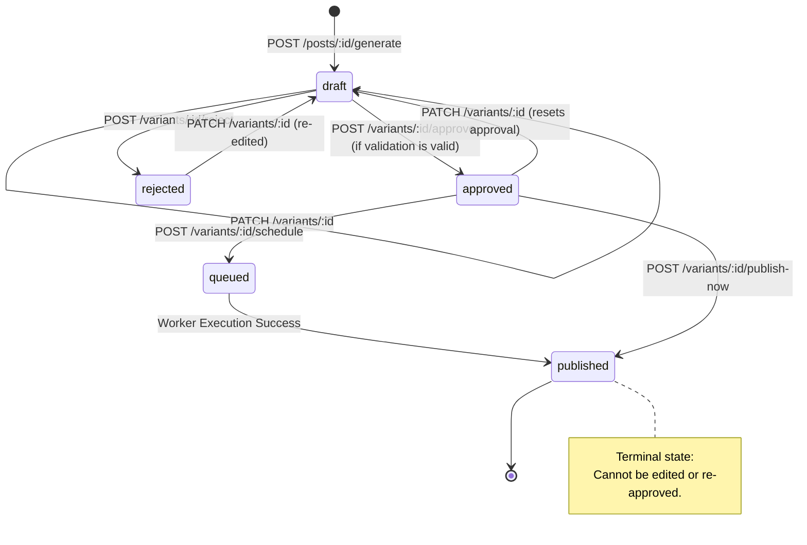

# Social Media Studio — FlyRank Backend Capstone

[](#-running-tests)
[](https://nodejs.org)
[](https://github.com/WiseLibs/better-sqlite3)
[](https://bullmq.io)
[](https://www.docker.com)

---

## 1. Project Overview

**Social Media Studio** is an enterprise-grade backend service built in Node.js (ES Modules) that automates the lifecycle of transforming long-form blog articles into platform-optimized social media posts. The system ingests raw blog content, deterministically synthesizes platform-constrained variants, enforces human-in-the-loop editorial review, schedules durable publishing slots via BullMQ and Redis, and idempotently publishes to live Telegram channels and simulated social networks (MockX and MockLinkedIn) with SQLite as the Single Source of Truth (SSOT).

---

## 2. Problem Being Solved

Content marketing teams face significant operational friction and reliability risks when syndicating long-form content across diverse social networks:
- **Platform Incompatibilities:** Every social channel has rigid character limits, distinct hashtag expectations, and formatting quirks (e.g. Telegram HTML vs. Twitter's strict 280-character limit vs. LinkedIn's thought-leadership tone).
- **Review Gating:** Automated AI or template systems risk publishing hallucinated or unapproved content if human editorial review is bypassed.
- **Double-Publishing Disasters:** Network retries, concurrent distributed workers, or process restarts frequently trigger catastrophic duplicate publications.
- **Unreliable Queuing:** In-memory queue runners lose scheduled publications when worker instances restart or crash.

Social Media Studio solves this by pairing strict validation gates with database-enforced idempotency ($\text{SHA-256}(\text{variant\_id} + \text{slot})$) and boot-time reconciliation for durable queue workers.

---

## 3. Architecture Diagram



---

## 4. Technology Stack

- **Runtime & Language:** Node.js (v20+ LTS / v24+), ES Modules (`"type": "module"`).
- **Web Framework:** Express 5 (`express`).
- **Database Engine:** SQLite 3 via `better-sqlite3` with Write-Ahead Logging (`WAL`) mode enabled.
- **Durable Queue & Scheduler:** BullMQ (`bullmq`) backed by Redis (`ioredis` / Redis 7).
- **Containerization:** Docker & Docker Compose (`redis:7-alpine`).
- **HTML Extraction:** Cheerio (`cheerio`) for semantic web scraping and OpenGraph metadata parsing.
- **Schema & Input Validation:** Zod (`zod`).
- **Testing & Mocking:** Vitest (`vitest`), Supertest (`supertest`), and `ioredis-mock`.

---

## 5. Setup Requirements

- **Node.js**: `v20.0.0` or higher installed (`node -v`).
- **Docker & Docker Compose**: Installed and running (for live Redis queue persistence).
- **Telegram Account (Optional for Real Testing)**: A Telegram Bot Token from `@BotFather` and a channel/chat ID where the bot has administrator/post permissions.

---

## 6. Docker Setup

To run the Redis durable queue instance via Docker Compose:

```bash
# Start Redis container in detached mode
docker-compose up -d

# Verify Redis container health
docker-compose ps
```

To shut down the Redis container:
```bash
docker-compose down
```

---

## 7. Environment Variables

Create your local `.env` file from the provided `.env.example`:

```bash
cp .env.example .env
```

| Variable | Type | Default | Description |
| :--- | :--- | :--- | :--- |
| `PORT` | Number | `3000` | Port for the Express API server. |
| `NODE_ENV` | String | `development` | Environment mode (`development`, `test`, `production`). |
| `DATABASE_PATH` | String | `./data/social_studio.sqlite` | SQLite database file location (`:memory:` supported). |
| `REDIS_HOST` | String | `127.0.0.1` | Redis host for BullMQ durable queuing. |
| `REDIS_PORT` | Number | `6379` | Redis port for BullMQ. |
| `REDIS_URL` | String | *(Optional)* | Full Redis connection URI (e.g. `redis://127.0.0.1:6379`). |
| `USE_IN_MEMORY_REDIS` | Boolean | `false` | Fallback in-memory queue mode when running without Redis. |
| `TELEGRAM_BOT_TOKEN` | String | `""` | Telegram Bot Token from `@BotFather` (never committed). |
| `TELEGRAM_CHAT_ID` | String | `""` | Telegram channel username (`@channel`) or chat ID (`-100...`). |
| `MOCK_X_FAILURE_RATE` | Number | `0` | Probability (0.0 - 1.0) of simulated Twitter/X failures. |
| `MOCK_LINKEDIN_FAILURE_RATE`| Number | `0` | Probability (0.0 - 1.0) of simulated LinkedIn failures. |

---

## 8. Seed / Sample Data Instructions

The SQLite database is initialized automatically upon first startup. The schema migrations run at boot and seed standard platform constraint profiles into the `constraint_profiles` table.

To test the system immediately with realistic sample content, use the included verification endpoints or run the ingestion route with a sample markdown article:

```bash
curl -X POST http://localhost:3000/posts \
  -H "Content-Type: application/json" \
  -d '{
    "markdown": "# Scaling Distributed Systems with Message Queues\n\nDistributed message queues enable decoupled background processing, smoothing out peak traffic loads and ensuring resilient task execution across microservices."
  }'
```

---

## 9. One-Command Run Instructions

### Option A: Standard Full-Stack Run (Docker Redis + API + Worker)

```bash
# 1. Start Redis in background
docker-compose up -d

# 2. Start API Server (Terminal 1)
npm run start:server

# 3. Start Publish Worker (Terminal 2)
npm run start:worker
```

### Option B: Zero-Config Standalone Dev Mode (Embedded In-Memory Queue)

```bash
# Run server with in-memory queue fallback enabled (no Docker required)
npm run dev
```

### Option C: Execute All 17 Automated Verification Suites

```bash
npm test
```

---

## 10. API Endpoint Documentation

### Ingestion API

- **`POST /posts`**
  - **Body (Markdown):** `{ "markdown": "# Title\n\nContent..." }`
  - **Body (URL):** `{ "url": "https://example.com/article" }`
  - *Constraint:* Exactly one of `markdown` or `url` is accepted.
- **`GET /posts`**: List all stored blog posts.
- **`GET /posts/:id`**: Retrieve post details with all associated variants.

### Variant Generation & Editing

- **`POST /posts/:id/generate`**
  - Generates platform variants (`telegram`, `mock_x`, `mock_linkedin`) from stored post content.
- **`GET /variants`**: List all variants (supports `?postId=...&status=...&platform=...`).
- **`GET /variants/:id`**: Get single variant details.
- **`PATCH /variants/:id`**
  - **Body:** `{ "content": "Updated text...", "hashtags": ["#Tech"], "tone": "informative" }`
  - Edits variant and automatically resets status to `draft` for re-review.
  - *Constraint:* Published variants cannot be edited (returns 400).

### Review Workflow

- **`POST /variants/:id/approve`**: Approve draft variant (only valid variants can be approved).
- **`POST /variants/:id/reject`**: Reject variant with `{ "reason": "Editorial feedback..." }`.

### Scheduling & Publishing

- **`POST /variants/:id/schedule`**
  - **Body:** `{ "scheduled_for": "2026-10-02T15:00:00.000Z" }`
  - *Constraint:* Only `approved` variants can be scheduled (returns 400 for `draft` or `rejected`).
- **`POST /variants/:id/publish-now`**: Synchronous immediate publish.
- **`GET /schedules`**: List all scheduled publish jobs.
- **`DELETE /schedules/:id`**: Cancel a queued schedule.

### Audit & History

- **`GET /publish-history`**: Complete publishing audit trail with joined variant and slot info.
- **`GET /publish-history/:variantId`**: Filtered publishing attempts for a specific variant.
- **`GET /health`**: Healthcheck endpoint exposing database and Redis connection status.

---

## 11. Variant Workflow

1. **Source Ingestion:** Blog content is stored in the `posts` table as the Single Source of Truth (SSOT).
2. **Template Synthesis:** `VariantGenerator` reads strictly from SQLite and applies platform templates.
3. **Draft Assignment:** Stored in `post_variants` with `status = 'draft'` and `validation_status = 'valid' | 'invalid'`.
4. **Editorial Moderation:** Editor inspects draft. Only approved variants can be scheduled.

---

## 12. Constraint Profiles

| Platform | Max Chars | Min Hashtags | Max Hashtags | Allowed Tones | Media Allowed |
| :--- | :--- | :--- | :--- | :--- | :--- |
| **Telegram** | 4,096 | 0 | 10 | `professional`, `casual`, `urgent`, `informative`, `engaging` | Yes |
| **MockX (Twitter)** | 280 | 1 | 4 | `casual`, `urgent`, `witty`, `punchy`, `informative` | Yes |
| **MockLinkedIn** | 3,000 | 2 | 5 | `professional`, `thought-leadership`, `industry-insight`, `informative` | Yes |

Violations immediately fail validation and are blocked from approval with a descriptive 4xx response:
```json
{
  "success": false,
  "error": {
    "message": "Variant exceeds maximum length for mock_x: 302 > 280",
    "code": "CONSTRAINT_VALIDATION_ERROR"
  }
}
```

---

## 13. Review Workflow State Machine



---

## 14. Adapter Architecture (Polymorphic Zero-Conditional Dispatch)

All publishing targets implement the unified contract defined in [`src/publishers/socialPublisher.js`](file:///d:/Social%20Media%20Studio%20Capstone/src/publishers/socialPublisher.js):

```javascript
export class SocialPublisher {
  async publish(variant, context = {}) {
    // Returns { success, external_id, url, published_at, message, preview, error, duration_ms, raw_response }
  }
}
```

- **Polymorphism Rule:** Core business logic and workers contain **zero** `if (platform === 'telegram')` conditional branching.
- **Factory Registration:** Adapters are registered in [`PublisherRegistry`](file:///d:/Social%20Media%20Studio%20Capstone/src/publishers/publisherRegistry.js) and resolved dynamically.

---

## 15. Telegram Setup (Real Target)

1. Open Telegram and message `@BotFather` to create a new bot (`/newbot`).
2. Copy the HTTP API token into `TELEGRAM_BOT_TOKEN` in your `.env`.
3. Create a Telegram Channel or Group, add your bot as an **Administrator** with permission to post messages.
4. Set `TELEGRAM_CHAT_ID` in `.env` to your public channel username (e.g. `@MyDevChannel`) or numeric ID (e.g. `-1001234567890`).
5. **Security Assurance:** Credentials come *strictly* from environment variables. The bot token is never committed, never logged, and redacted in audit responses.

---

## 16. Mock Adapter Behavior

- **`MockXPublisher`:** Simulates X/Twitter tweet posting with 10-50ms synthetic network latency, formats a character-counted preview string (`[Twitter/X Preview] (210/280 chars)`), writes the structured payload to the database, and returns mock status URLs (`https://x.com/SocialStudioBot/status/tw_...`).
- **`MockLinkedInPublisher`:** Simulates LinkedIn share latency, generates professional previews (`[LinkedIn Professional Preview]`), writes payload to SQLite, and returns URN identifiers (`urn:li:share:...`).

---

## 17. Scheduling Architecture

1. **Client Request:** `POST /variants/:id/schedule` with ISO datetime.
2. **Database Schedule:** Creates row in SQLite `schedules` with status `queued` and unique `idempotency_key`.
3. **BullMQ Delayed Task:** Pushes delayed job to BullMQ queue with `delay = scheduled_time - Date.now()`.
4. **Worker Dispatch:** `PublishWorker` picks up job when due, claims row atomically, and triggers publisher adapter.

---

## 18. Idempotency Strategy

Idempotency is enforced at the **Database Level**, eliminating reliance on volatile memory or queue IDs:

1. **Deterministic Slot Hashing:**
   $$\text{IdempotencyKey} = \text{SHA-256}(\text{variant\_id} + \text{ISO\_ROUNDED\_SLOT})$$
2. **SQLite Table Constraint:** `schedules(idempotency_key)` is `UNIQUE`. Duplicate scheduling requests are rejected with `409 Conflict`.
3. **Partial Unique Index:** `idx_publish_logs_unique_success` on `publish_logs(idempotency_key) WHERE status = 'success'` prevents duplicate success rows.
4. **Pre-dispatch Lock:** Worker queries `findSuccessByIdempotencyKey(key)` before calling external APIs. If present, it skips dispatch immediately.

---

## 19. Worker Restart Behavior & Reconciliation

When the background worker crashes or the server host restarts:
1. Pending jobs remain recorded in SQLite (`status = 'queued'` or `status = 'processing'`).
2. On boot, `ReconciliationService.reconcile()` queries all uncompleted schedules.
3. Cross-checks against `publish_logs` to ensure no completed job is re-dispatched.
4. Re-enqueues orphaned schedules into BullMQ with their original idempotency keys.
5. In-flight jobs are recovered seamlessly with **zero lost tasks and zero double-publications**.

---

## 20. Publish History

Every publication attempt is recorded in `publish_logs` and queryable via `GET /publish-history`:
```json
[
  {
    "id": "e91fa230-0112-4211-a889-112233445566",
    "schedule_id": "ad2a5b5b-e298-4d13-b05c-2a00d9a6cc5f",
    "variant_id": "7b58c732-c649-411a-8bb7-f10f845a7c29",
    "platform": "telegram",
    "scheduled_slot": "2026-10-02T15:02:00.000Z",
    "idempotency_key": "c71e21b730fef6e53a39fbc859235921bbd8108ef942d93e157790b4d4586f37",
    "attempt_time": "2026-10-02 13:42:25",
    "status": "success",
    "external_id": "58292",
    "url": "https://t.me/FlyRankStudioChannel/58292",
    "duration_ms": 112
  }
]
```

---

## 21. Known Limitations

- **Telegram Rate Limits:** Telegram Bot API limits channel broadcast rate to ~20-30 messages per minute. Production high-scale deployments should configure BullMQ rate-limiter options.
- **Single SQLite File:** While WAL mode supports high concurrent read throughput, SQLite restricts write operations to a single process thread at any given microsecond.

---

## 22. Explicit Non-Goals

- **Paid AI Model Integration:** This service intentionally uses deterministic template generators to remain 100% free with zero token fees or credit card requirements.
- **Frontend UI Framework:** The project is strictly a headless backend REST service.
- **Live OAuth2 for Twitter/LinkedIn:** Real OAuth credentials for X and LinkedIn are excluded per the project specification; Mock adapters provide full preview and database auditing.
